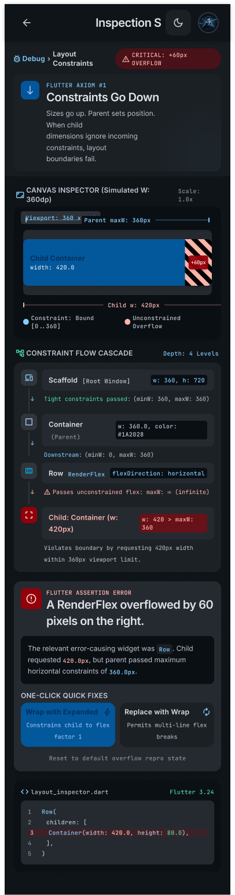

# WidgetLab 🚀

**An Interactive Flutter Widget Guide for Learning, Exploring, and Understanding Flutter Widgets.**

WidgetLab is a cross-platform mobile application built with Flutter that helps developers understand how Flutter widgets work through interactive demonstrations and practical examples.

Whether you're a beginner learning Flutter or an experienced developer looking to explore widget behavior, WidgetLab provides a hands-on environment where you can experiment with widget properties, compare layouts, visualize constraints, and understand common implementation mistakes.

## ✨ Features

- **Widget Library:** Explore a collection of Flutter widgets with descriptions and practical examples.
- **Interactive Widget Playground:** Experiment with widgets and adjust their properties to see changes in real time.
- **Common Mistakes:** Learn about frequently encountered Flutter widget mistakes and how to avoid them.
- **Widget Comparison:** Compare similar widgets, such as `Row` and `Wrap`, to understand their differences and appropriate use cases.
- **Constraint Visualizer:** Understand how Flutter's layout and constraint system works through visual demonstrations.
- **Practical Examples:** Learn through real widget demonstrations rather than documentation alone.
- **Cross-Platform Support:** Designed for Android and iOS.

## 📸 Screenshots

The following screenshots showcase the main UI sections of WidgetLab.

| Widget Library                                             | Widget Playground                                                          |
| ---------------------------------------------------------- | -------------------------------------------------------------------------- |
|  |  |

| Common Mistakes                                              | Widget Comparison                                                       |
| ------------------------------------------------------------ | ----------------------------------------------------------------------- |
|  |  |

| Constraint Visualizer                                                  |
| ---------------------------------------------------------------------- |
|  |

## 🛠️ Tech Stack

- **Framework:** Flutter
- **Programming Language:** Dart
- **Platforms:** Android and iOS
- **UI:** Flutter Material Design and custom widgets
- **Development Tools:** Android Studio / Visual Studio Code
- **Version Control:** Git and GitHub

## 🚀 Getting Started

Follow these instructions to set up WidgetLab locally.

### Prerequisites

Make sure you have the following installed:

- Flutter SDK
- Dart SDK (included with Flutter)
- Android Studio or Visual Studio Code
- Android SDK and an emulator, or a physical Android device
- Xcode (required for iOS development on macOS)
- Git

Verify your Flutter installation:

```bash
flutter doctor
```

### Clone the Repository

```bash
git clone https://github.com/YOUR_USERNAME/WidgetLab.git
```

Navigate to the project directory:

```bash
cd WidgetLab
```

## ⚙️ Environment Setup

1. Install the Flutter SDK using the official [Flutter installation guide](https://docs.flutter.dev/get-started/install).
2. Configure your Flutter SDK path.
3. Set up an Android emulator or connect a physical device.
4. For iOS development, configure Xcode and CocoaPods on macOS.
5. Verify that all required development tools are configured:

```bash
flutter doctor -v
```

Install the project dependencies:

```bash
flutter pub get
```

> **Note:** If the project requires API keys, external service credentials, or environment-specific configuration, configure them locally before running the application. Never commit private credentials to GitHub.

## ▶️ Running the App

Check the connected devices:

```bash
flutter devices
```

Run the application in debug mode:

```bash
flutter run
```

Run on a specific device:

```bash
flutter run -d DEVICE_ID
```

For hot reload during development, press `r` in the terminal running the application.

## 📦 Building for Release

### Android APK

```bash
flutter build apk --release
```

### Android App Bundle

```bash
flutter build appbundle --release
```

### iOS

On macOS, build the iOS release version:

```bash
flutter build ios --release
```

For App Store distribution, configure signing and provisioning in Xcode before archiving and submitting the application.

## 📁 Project Structure

The project follows a feature-oriented Flutter structure. The tree below is a suggested organizational layout; adjust it to match the actual folders in your repository.

```text
WidgetLab/
│
├── android/                 # Android platform configuration
├── ios/                     # iOS platform configuration
├── assets/
│   ├── images/              # Application images
│   ├── icons/               # Custom icons
│   └── fonts/               # Custom fonts
│
├── lib/
│   ├── core/                # Shared utilities and configuration
│   ├── data/                # Static data and widget information
│   ├── models/              # Data models
│   ├── features/
│   │   ├── widget_library/  # Widget library screens
│   │   ├── playground/      # Interactive widget demonstrations
│   │   ├── comparisons/     # Widget comparison screens
│   │   ├── mistakes/        # Common Flutter mistakes
│   │   └── constraints/     # Constraint visualizer
│   │
│   ├── shared/              # Reusable UI components
│   └── main.dart            # Application entry point
│
├── screenshots/             # README application screenshots
├── test/                    # Application tests
├── pubspec.yaml             # Dependencies and project configuration
├── analysis_options.yaml    # Dart analysis configuration
└── README.md
```

## 🤝 Contributing

Contributions, suggestions, and improvements are welcome!

If you'd like to contribute:

1. Fork the repository.
2. Create a new branch:

```bash
git checkout -b feature/your-feature-name
```

3. Make your changes.
4. Run the project and test your changes.
5. Commit your changes:

```bash
git commit -m "Add: your feature description"
```

6. Push your branch:

```bash
git push origin feature/your-feature-name
```

7. Open a Pull Request describing your changes.

## 📄 License

This project is currently available for learning and educational purposes.

A formal open-source license has not yet been selected. Until one is added, all rights are reserved by the project author. If you intend to distribute the project as open source, consider adding an appropriate license such as the MIT License.

---

**Built with ❤️ using Flutter and Dart.**

If you find WidgetLab useful, consider giving the repository a ⭐ on GitHub!
